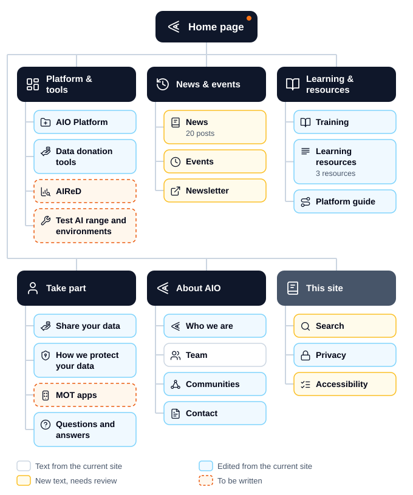

## The plan in short

The Australian Internet Observatory (AIO) replaces its WordPress website with a small static site. A static site is a set of finished pages. The server does not run a program when somebody opens a page, so the site does not need a database, a login page, or plug-ins.

- **Astro** builds the site. It turns text files into finished pages once, when the site is built.
- **Markdown** files hold every page and post. Markdown is plain text with simple marks, for example `##` for a heading.
- **GitHub** stores the files in a repository, a shared folder that records every change.
- **GitHub Pages** publishes the site without cost. A GitHub workflow, a script that GitHub runs, rebuilds the site after each change and every night.
- **Pages CMS**, a free web editor for files in GitHub, lets the outreach team add news and edit pages in the browser.

The test version of the site is in the folder of this plan. It uses the menu of the Miro board, the online whiteboard of the team, and contains the text of the current site. Every page has a comment box that works once the shared comment service is connected. Section 11 lists the decisions that are still open.

## 1. All pages

The graph shows every page of the new site, grouped as in the menu. Each box links to its page. The colour of a box shows the status of the text of that page, for example "To be written".

The build draws this graph again from the menu file (`src/data/navigation.json`) and from the status field of each page. So the graph and the menu always agree.

## 2. Why the current site needs to change

On 14 November 2026 I read all 46 addresses of the current site (internetobservatory.org.au). They are 15 pages, 28 posts, and 3 news lists.

| Problem | Evidence |
|---|---|
| Heavy pages | The home page (`/`) loads 948 KB in 68 files, with 26 script elements and 33 style sheets. |
| Two home pages | `/` and `/home-2/` are both titled "Home", and about 70% of their text is the same. |
| Links without a target | Four cards on `/home-2/` have no link target. "View all news + updates" links to `#`. |
| One list shown three times | `/news-and-events/` and its two sub-lists show the same 21 items. |
| Placeholder content | `/privacy-policy/` is template text with a `localhost` address. `/global-search/` is empty. |
| Vague labels | "Explore", "Observe", and "Learn" do not say what the reader finds. |
| Little for participants | People who are asked to share their data have one page, and two of its buttons are broken. |

`docs/inventory.md` lists every current address with its verdict (keep, merge, or drop). The local `docs/wordpress-copy/` archive contains a copy of the current text and is excluded from Git.

## 3. The menu

The menu uses the lower part of the Miro board, titled "New AIO". Each group heading opens a short list, without a page of its own, and each item in the list is one short page.

| Group | Pages |
|---|---|
| Platform & tools | AIO Platform, Data collection tools, AIReD, Test AI range and environments |
| News & events | News, Events, Case studies, Newsletter |
| Learning & resources | Training, Learning resources, Platform guide |
| Take part | Share your data, How we protect your data, MOT apps, Questions and answers |
| About AIO | Who we are, Team, Funding, Communities, Contact |

The button **Launch AIO Platform** stays at the right end of the menu on every page and opens app.internetobservatory.org.au. The footer has links to Search, Privacy, Accessibility, Contact, the newsletter, and the social channels.

These parts of the menu are new, or placed differently from the board:

- **Take part.** A person who is asked to donate data needs one clear place to go. The group collects the pages that the board lists "to fit in".
- **Data collection tools.** This page is new in the menu. It contains the text of the current Observe page, the main description of the AIO methods.
- **Communities** is on the board only with a question mark. It sits under About AIO.

Three pages are still to be written. They show a "To be written" box.

- **AIReD**, the Australian Internet Research Dashboard. The page uses the description from Module 7 of the learning system, marked for review.
- **Test AI range and environments.** The board has these words in one box, so the test version treats them as one page.
- **MOT apps.** MOT is the Mobile Observatory Ad Toolkit. The page needs a description of the apps for participants, for example Mobile Rover and Browser Rover.

Each old address has a redirect page, a small page that sends the browser to the new address. So links in emails, papers, and search results keep their target.

Learning resources are sorted by Diátaxis, the map on the board. Diátaxis sorts documentation into four kinds by what the reader needs:

- **Tutorials** teach by practice. The modules of the learning system are the tutorials.
- **How-to guides** help with one task, for example the Research Ethics Guide.
- **Explanations** build understanding, for example the explainer on Data Download Packages (DDPs), the copies of the users' data that platforms provide to them.
- **Reference** pages answer questions, for example Questions and answers.

## 4. How the site works

Every page, post, and resource is one Markdown file. A short block at the top of each file, the front matter, contains its fields, for example the title, the date, and the summary. The build checks these fields. If a post lacks a title, the build stops and names the file, and the live site stays as it was.

| Content | Folder or file |
|---|---|
| Pages | `src/content/pages/` (the file `about/team.md` becomes the page `/about/team/`) |
| News, events, and case studies | `src/content/posts/` |
| Learning resources | `src/content/resources/` |
| Settings: Platform address, feedback, analytics, social links | `src/data/site.json` |
| Menu | `src/data/navigation.json` |
| Training modules | `src/data/training.json` |

To publish a change:

1. An editor saves the change in Pages CMS or in GitHub's file editor.
2. GitHub records the change as a commit, a saved version of the files, with its date and author.
3. The workflow builds the site, checks every link, and publishes the site within about 2 minutes of the commit.

A post with `draft: true` stays out of the site, so editors can prepare news in advance. The nightly build moves each event from "Upcoming" to "Past events" on the day after it ends. Search uses Pagefind, which builds the search index at build time, so the site does not need a search server.

The test version shows the banner "Test – Under Development". It also shows a label on each page with the status of its text, a comment box, and a heading link (#) on each section. It asks search engines not to list the site. At launch, one setting, `"draft": false` in `src/data/site.json`, removes the banner, the labels, the comment box, the heading links, and this request. It is a different setting from `draft: true` in a post.

Once the Google Sheets comment service is connected, reviewers can comment on a page, part of a page, or the menu. The review page (`/review/`) sends answers to eight questions to the same sheet. Reviewers do not need an account. The service address is public, so comments and names must not contain private information. `README.md` explains setup and access.

## 5. Technology and design

On 14 November 2026 I compared four site generators, Astro, Eleventy, Hugo, and Jekyll. Astro checks every content file against a schema and has an official GitHub Pages workflow. It does not send JavaScript to visitors unless a page asks for it. Eleventy is the alternative to Astro. Hugo has a template language that is hard to hand over to a new developer, and Jekyll has not had a release for 21 months.

| Part | Tool | Cost |
|---|---|---|
| Site generator | Astro 7.4.12 | Free |
| Host | GitHub Pages | Free |
| Build and publication | GitHub workflow `deploy.yml` | Free |
| Search | Pagefind 1.6.0 | Free |
| Browser editor | Pages CMS, with GitHub's file editor as the fallback | Free, see sections 6 and 9 |
| Analytics | GoatCounter, without cookies | Free for reasonable public use, supported by donations |
| Newsletter | Mailchimp, as now | Unchanged |

The site uses the design of the AIO learning system, so the two sites look the same:

- the AIO logo of the learning system
- the fonts Space Grotesk for headings and Inter Tight for text, stored on the site itself, at a text size of 18 pixels
- the icon set of the learning system, with a text label beside each icon
- slate greys with one orange accent, with the same colours as the learning system (`src/styles/tokens.css`)
- the diagrams of the learning system, for example the steps of a data donation on the Take part page
- one width for the content of every page, with equal margins on the left and the right

## 6. Editors

**Pages CMS** is a hosted editor at app.pagescms.org. It reads `.pages.yml`, its settings file in the repository, and shows one form for each kind of content. An editor fills in the form, adds an image, and saves. The owner of the repository installs the Pages CMS GitHub App, an add-on that lets Pages CMS save to the repository, once. According to the Pages CMS website, editors can be invited by email and do not need a GitHub account. I did not test Pages CMS, so `EDITING.md` lists the test that one person must do before the team relies on it.

**GitHub's file editor** is the fallback. The footer of each page has the link "Edit this page on GitHub". Each editor then needs a GitHub account with write access to the repository.

Editors change the text of pages and add posts and resources. A new page also needs an item in the menu, so the developer who builds the site adds new pages.

**The post editor of the test version** (`/editor/`) works without an account. Anyone with its address can add a news post, an event or a case study, or change one. The post then waits in the `Posts` tab of the shared sheet. A team member who can edit the sheet sets its status to "approve", and a script saves the post to GitHub. The site shows it about 2 minutes later. The editor exists only in the test version, as the review page does.

## 7. How the site connects to the rest of AIO

| Element | Connection |
|---|---|
| AIO Platform | The button "Launch AIO Platform" on every page. The Platform guide explains the first steps. |
| Learning system | The Training page lists the modules from `src/data/training.json`. When `trainingUrl` in `src/data/site.json` is set, each available module links to its place in the learning system. |
| YouTube | A video shows as a still image. The YouTube player loads only after a click, so YouTube sets cookies only after that click. |
| Newsletter | A link to the current Mailchimp sign-up form |
| Social channels | Bluesky, YouTube, and LinkedIn, in the footer |
| News feed | `rss.xml`, so partners and the newsletter can collect new posts |
| Analytics | GoatCounter counts page views without cookies when its code is set in `src/data/site.json`. |

The learning system will have its address on the website. Its static copy, which runs without a server, can be placed at `/training/`, and the website keeps that address free. The current static copy of the learning system dates from 17 September 2026 and lacks the activities. So it must be built again before it goes on the site. Until then, the Training page marks Modules 1, 4, 5.1 and 5.2 as available and the other six as "In preparation".

Text by AIO, for example the guides and explainers, is published under the licence CC BY 4.0. Republished articles keep the licence of their first publisher.

## 8. Steps to launch

**Step A. Put the test version online.**

1. Choose the files that go into the public repository. A push publishes every tracked file. `.gitignore` excludes the WordPress archive, the Miro board exports (`New AIO website IA.*`) and other local files, but does not remove files already tracked.
2. Create the public repository `aio-website` in a personal GitHub account. The site then appears at `<account>.github.io/aio-website/`.
3. In the repository, open Settings › Pages, and set Source to "GitHub Actions".
4. Push this folder to the branch `main`, the main line of the repository. The workflow "Deploy to GitHub Pages" publishes the site.
5. In `src/data/site.json`, set `repository` to the address of the repository, for the link "Edit this page on GitHub".
6. Send the address to the reviewers, with the last day of the review.

**Step B. Review.** Reviewers comment on the test version. One person collects the comments into one list of changes, and the team makes the decisions in section 11.

**Step C. Build the real site.** A casual web developer does this work, in five parts:

- the changes from the review to the menu, the design, and the home page
- the copy of all images from the WordPress server into the repository
- an accessibility check against the Web Content Accessibility Guidelines (WCAG) 2.2 level AA with phones, the keyboard, and a screen reader, and its corrections
- the setup and test of Pages CMS, the editing interface, and a short introduction for the outreach team
- the move of the domain and a test of the old addresses

The outreach team enters the text of the pages marked "To be written" through Pages CMS, as it does for news and events.

**Step D. Move the domain.**

1. Find who manages the DNS records of internetobservatory.org.au. DNS is the system that points a domain name to a server.
2. Set `"draft": false` in `src/data/site.json`.
3. In Settings › Pages, set the custom domain to internetobservatory.org.au and turn on "Enforce HTTPS".
4. Change the DNS records as the guide of GitHub describes.
5. Open a sample of old addresses, for example `/faq/` and `/explore/observe/`, and check that they redirect.
6. Keep the WordPress site, unpublished, for 3 months as a fallback.

**Step E. The learning system.** From January 2027, the same developer prepares the learning system for publication and places its static copy on the website.

## 9. Risks

| Risk | What reduces it |
|---|---|
| Pages CMS changes its price or stops. | The files stay in GitHub. GitHub's file editor or Sveltia CMS, another free web editor, can edit the same files. |
| A save in Pages CMS damages a file. | The settings file `.pages.yml` tells Pages CMS to keep the fields that its forms do not show. The test in `EDITING.md` checks this. |
| Images stay on the WordPress server. | Step C copies them into the repository before the domain moves. |
| Republished articles lose the credit of their first publisher. | Some posts first appeared in The Conversation and 360info. Their credit line and the link to the original stay with each post. |
| The privacy text is out of date. | A privacy contact named by AIO reviews the Privacy page before launch. The review also covers the still images that pages load from YouTube and the WordPress server. |
| Anyone with the address of the post editor can submit a post. | Every post waits for approval in the sheet. The store refuses raw HTML except the video block. Only team members may edit the sheet, and the token can write files in this one repository only. |
| Test feedback is publicly accessible through the comment service. | Reviewers are told not to include private information. The sheet can be restricted, but the service is not private. |
| The site depends on one developer. | The code is small and uses one standard tool, Astro. `README.md` and `EDITING.md` explain it. |

## 10. Measured on the test version

I built the test version under the sub-path `/aio-website/`, the folder of its address on GitHub Pages, on 16 November 2026. "Sent" is the size after the compression that GitHub Pages applies.

| Measure | Current site | Test version | Target |
|---|---|---|---|
| Home page, sent before images | not measured (948 KB with images, section 2) | 82 KB in 5 files, of which 67 KB are the two fonts and 3 KB the comment script of the test version | at most 100 KB |
| Script elements on the home page | 26 | 3, which are two short ones inside the page and the comment script of the test version | only the scripts that a page needs |
| Pages built | not applicable | 108, of which 56 are redirect pages. 43 redirect pages serve changed addresses of section 2, and 13 serve tag, category, and short addresses of the current site. | no target |
| Internal links and images checked | not applicable | 5,764, all working | all working |
| Build time | not applicable | about 2 seconds | no target |

When its code is set, GoatCounter adds one script file of about 3.5 KB. I also tested search, a redirect, the menu with the keyboard, and every page type at a phone width of 375 pixels. I did not test with a screen reader.

## 11. Decisions

These decisions are made for the test version:

1. Comments on the test version go to a shared Google Sheet.
2. The menu has the group "Take part".
3. Group headings open their lists, without pages of their own.
4. MOT is the Mobile Observatory Ad Toolkit.
5. Pages CMS is the editor.
6. The test version is in a personal GitHub repository.
7. The learning system will have its address on the website.
8. The site counts visits with GoatCounter.
9. The footer shows the funding statement of the Australian Research Data Commons (ARDC), without an Acknowledgement of Country.
10. Text by AIO is published under CC BY 4.0.

These decisions are still open:

1. **Owners of the pages that need text or confirmation.** Who writes or confirms each of these pages? I recommend one named owner for each page.
   - AIReD
   - Test AI range and environments, and whether it is one page or two
   - MOT apps
   - Share your data, with the list of open studies
   - Newsletter, with the archive of past issues
   - Privacy
   - Accessibility, with the result of the check
2. **Repository for the real site.** Which GitHub account or organisation owns the repository at launch? I recommend an AIO organisation, so that the site does not depend on one person.
